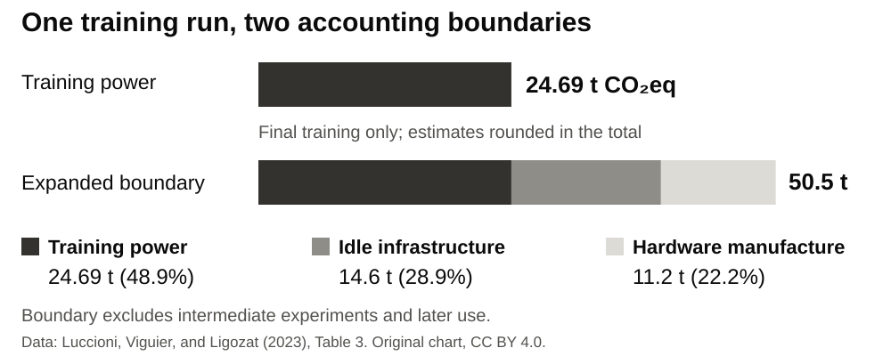
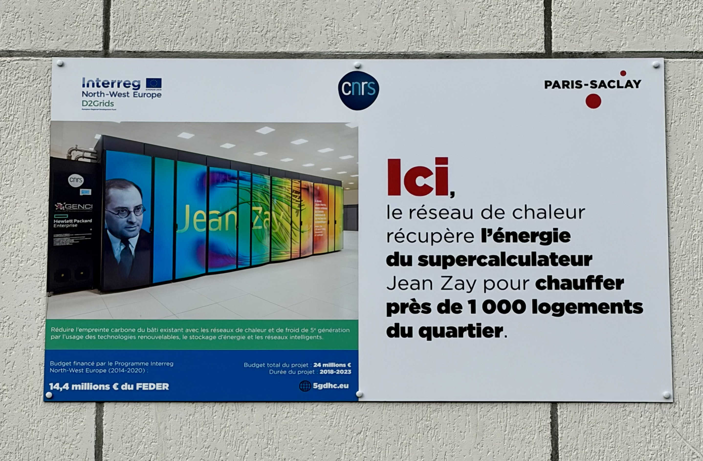
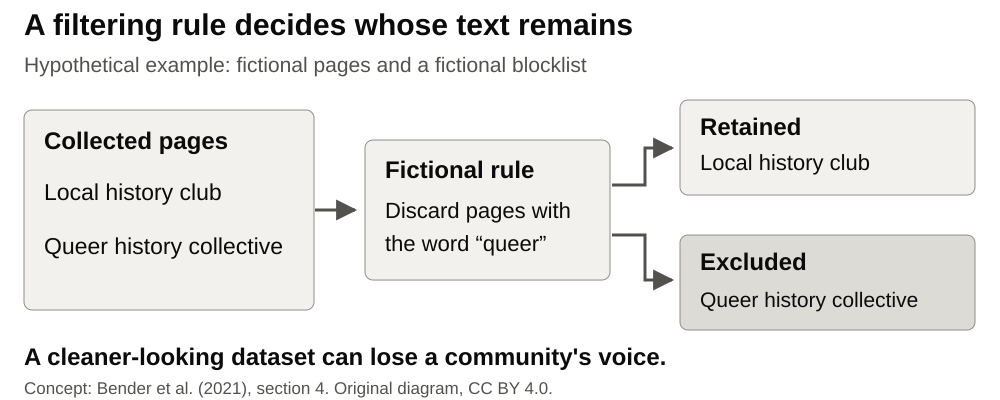

## What did BLOOM's training cost?

[Documented case]{.label}

{fig-alt="Two accounting boundaries for BLOOM's final training. Training power alone: 24.69 tonnes CO2 equivalent. Adding idle infrastructure and hardware manufacture gives a rounded 50.5 tonnes. Experiments and later use are excluded."}

**Which costs disappear when we count only the training power?**

[Estimates for final training: @luccioni2023, Table 3. Original chart, CC BY 4.0.]{.source}

::: notes
Start with the chart. Participants have read Bender et al.; do not start with another summary of the paper. Ask them to identify the parts left out of the first bar. The expanded boundary includes 14.6 t from idle infrastructure and 11.2 t from hardware manufacture. Rounded values sum to 50.49 t; the paper reports 50.5 t. These are estimates built from measured energy and accounting assumptions, not a complete footprint for every use of BLOOM [@luccioni2023].

BLOOM has 176 billion parameters. It was trained on Jean Zay in France. Its ROOTS training corpus has 46 natural and 13 programming languages [@laurencon2022; @luccioni2023]. The example makes Bender et al.'s environmental costs concrete [@bender2021, sec. 3].
:::

## The model runs somewhere

{height="365" fig-alt="Photograph of a public information panel at the Jean Zay site. It shows server cabinets and describes a heat-recovery network."}

**Hardware · electricity · cooling · location**

[Site context photographed in 2026: Clemcloum8, CC0 [@clemcloum2026]. The panel is not evidence for BLOOM's training footprint.]{.source}

::: notes
The panel makes the physical infrastructure visible. It was photographed after BLOOM's training. Do not subtract its heat-recovery claim from the 2023 paper's estimates. The photo does not establish the hardware configuration or heating arrangements during BLOOM's training.

The learning question is: Which environmental and data choices are hidden by a model's apparent performance? Bender et al. connect environmental costs with unequal distributions of benefit and harm [@bender2021, sec. 3]. Crawford follows this material base through mines, grids, and supply chains [@crawford2021, ch. 1].

Optional background belongs here, not on the projected slide: the IEA's data-center totals are sector-wide estimates and projections [@iea2025]. The water figure in Li et al. is an estimate with explicit assumptions [@li2025]. Neither provides a per-request measurement for the group's own tool.
:::

## Training data: who survives the filter?

{fig-alt="Hypothetical example with fictional pages and a fictional blocklist. A rule discards a page about queer history because it contains the word queer, while retaining a local history page."}

[Hypothetical illustration of exclusion. Concept: @bender2021, sec. 4. Original diagram, CC BY 4.0.]{.source}

::: notes
Ask which page the rule loses. The pages and the specific rule are invented for teaching. Do not present them as a sample from C4 or BLOOM.

Then connect the example to the documented argument. Bender et al. discuss how C4's blocklist filtering excludes LGBTQ-related text and how web-scale collection overrepresents dominant viewpoints [@bender2021, sec. 4]. A larger dataset does not establish broader representation. The choice of a filter is a value choice. The filtering example is a separate illustration; it does not describe BLOOM's data pipeline.
:::

## Documentation debt: what can you trace?

::: {.columns .trace-cards}

::: {.column width="33%"}

### Source

Where did the training text come from?
:::

::: {.column width="33%"}

### Filter

What was excluded, and by whom?
:::

::: {.column width="33%"}

### Record

Can someone check those decisions?
:::

:::

**An undocumented choice becomes harder to question.**

[Concept: @bender2021, sec. 4.]{.source}

::: notes
Recall documentation debt from the assigned paper: collecting more data than one can document makes later accountability harder [@bender2021, 615]. Use the fictional filtering example: if the filter's rule is missing, how would the excluded group identify what happened?

BLOOM's open reporting illustrates what can be recorded. ROOTS and the BigScience governance work document data sources and decisions [@laurencon2022; @jernite2022]. This does not make BLOOM cost-free or settle consent for all data. Ask participants which records exist for the tool they use.
:::

## A training footprint does not price your task

::: {.columns .trace-cards}

::: {.column width="50%"}

### Final training

**50.5 t CO₂eq**

One accounting boundary.
:::

::: {.column width="50%"}

### One deployment

**914 kWh over 18 days**

One observed pattern of use.
:::

:::

**For your task: what still needs measurement?**

[Separate studies within @luccioni2023. The values have different units and boundaries.]{.source}

::: notes
Do not add the two numbers. The 18-day API deployment served 230,768 requests; its hardware and conditions differ from final training. The study reports that keeping the model ready accounts for much of deployment energy [@luccioni2023, sec. 4.4]. It does not give the energy for a different research workflow.

Luccioni et al. compare generative and task-specific systems for several tasks [@luccioni2024]. A search tool, manual work, or a smaller model is an alternative to test at comparable quality. Do not promise a saving without checking the task and the boundary.
:::

## Worked map: two stages are enough to start

::: {.worked-example}



:::

::: notes
Show every filled field before handing over the task. This is a fictional research team considering BLOOM, using documented measurements. The known figures come from the paper. The unknowns concern the team's intended use. The actions are proposed choices, not measured savings.

Read the two selected stage names exactly as they appear on the worksheet. Mark all other stages Not examined. Explain that a blank cell is ambiguous; write Unknown when the evidence is missing. A group can use this prepared case if its own research description does not fit or if it prefers not to discuss it.
:::

## Activity · 15 minutes

**Make a material-and-provenance map.** Groups of three or four. Use paper or a laptop.

1. Choose your group's research use. Use BLOOM if needed or preferred. Select **2–3 stages**. **3 min**
2. Record **Known, Unknown, Avoidable** for those stages. Add sources. **8 min**
3. Mark the largest unknown and one avoidable cost. **2 min**
4. Prepare one sentence for the plenary. **2 min**

[Open the worksheet](../handouts/lens-1-provenance-map.qmd) · [Prepared BLOOM case](../lenses/01-scale.qmd#case-bloom)

::: notes
Own research remains the first choice. Describe the use without showing personal, confidential, or unpublished data. The author can explain the use during the first three minutes. Prepared BLOOM facts are already on the lesson page; this activity does not require additional reading or live searching.

Write Unknown for missing evidence within the selected stages. Mark unselected stages Not examined. Label suggested changes PROPOSED. At minute 13, call for: The choice that the performance of this system hides most is …
:::

## Expected output

**One focused material-and-provenance map per group.**

- **2–3 stages:** Known, Unknown, Avoidable, with sources.
- **Two findings:** the largest unknown and one avoidable cost.
- **One sentence:** "The choice that the performance of this system hides most is …"

::: notes
Check that each group has an explicit unknown and a proposed alternative, even when it cannot quantify a saving. The selected stages are the scope of this map. Do not require the rest of the grid or the twelve shared fields during these 15 minutes. Keep the map for later transfer to the shared fields in the clinic.
:::

## Takeaway

> A missing number is an unknown, not a zero.

**Ask about environmental costs, training data, and documentation debt.**

[Return to @bender2021, secs. 3–4.]{.source}

::: notes
Collect the plenary sentences. Keep the total lens slot at 35 minutes: case first, 5 minutes; concepts and worked map, 10 minutes; activity, 15 minutes; plenary, 5 minutes. Transition to Lens 2: We followed data as a cost. Next we follow data as a picture of the world.
:::

## Sources {.smaller}

- Bender et al. [-@bender2021]: environmental costs, training data, documentation debt.
- Luccioni, Viguier, and Ligozat [-@luccioni2023]: BLOOM footprint and deployment study.
- Laurençon et al. [-@laurencon2022]; Jernite et al. [-@jernite2022]: ROOTS and data governance.
- Luccioni, Jernite, and Strubell [-@luccioni2024]: comparing deployment tasks.
- Photo: Clemcloum8 [-@clemcloum2026], CC0. Original diagrams: CC BY 4.0.

[Full references and evidence limits](../lenses/01-scale.qmd#references)
