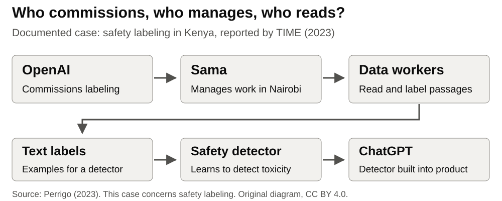
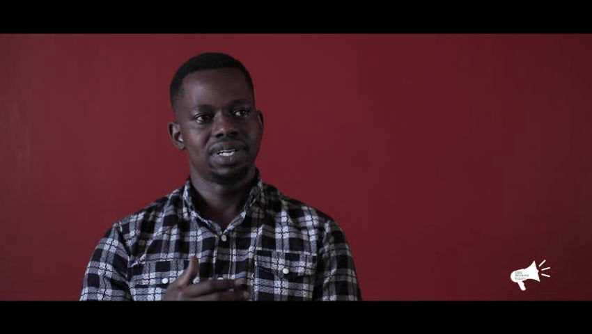
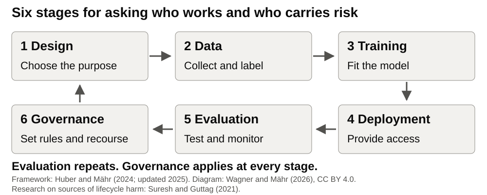

## Whose work makes ChatGPT safer?

[Documented case · Kenya safety labeling]{.label}

{fig-alt="OpenAI commissions labeling from Sama. Sama manages text labelers in Nairobi. Their labels help train a toxicity detector that is built into ChatGPT."}

**Who reads the text that users are protected from?**

[Case: @perrigo2023. Content note: workers read texts about violence and sexual abuse. No examples are shown.]{.source}

::: notes
Start with the work, not a lifecycle definition. The source is TIME's investigation from January 2023, based on interviews and documents. Workers labeled harmful passages for a toxicity detector. This is not the same task as writing and ranking answers for human-feedback training [@perrigo2023; @ouyang2022].

Ask participants to follow the work across the companies and workers in the diagram. The learning question is: Who does the work, carries the risk, or has no recourse?
:::

## Workers can speak and organize

{height="340" fig-alt="A non-graphic preview still from Richard Mathenge's documentary about data workers organizing. A speaker sits in front of a red wall."}

**A worker-led account makes hidden labor visible.**

[Contextual still: Mathenge [-@mathenge2024]; videography and editing: P. Teka, CC BY 4.0. This is a separate source from TIME's interviews.]{.source}

::: notes
The image is the published preview of the documentary Data Workers Organizing: The African Content Moderators Union. It is a source about organizing and working conditions at Sama, not a photograph of the labeling task in the 2021–2022 contract. Do not identify the speaker as one of TIME's anonymous interviewees. The film includes sensitive testimony; use this safe still without playing the film in class [@mathenge2024]. It is a figure source, not a new assigned reading.

The later organizing account shows why an unknown complaint route in a report is not evidence that workers lack agency. Distinguish worker-led action from what a researcher can change through an institution.
:::

## One safety intervention, unevenly carried costs

::: {.columns .trace-cards}

::: {.column width="50%"}

### Reported pay

**USD 1.32–2 per hour**

Reported take-home pay.
:::

::: {.column width="50%"}

### Reported harm

**Four interviewees**

All reported lasting distress.
:::

:::

**Counseling was reported. Access and benefit were disputed.**

[Reported facts: @perrigo2023. Conditions vary across projects.]{.source}

::: notes
TIME reviewed documents and interviewed four workers. This is a documented case, not a representative wage survey. Sama disputed the wage range and reported a higher range for some roles. Workers reported heavier workloads than Sama stated. Workers described counseling as ineffective or hard to access; Sama said both group and individual counseling were available. OpenAI said Sama managed pay and mental-health provisions [@perrigo2023]. Keep these disputes explicit; do not turn the four interviews into an industry-wide rate.

Use the lesson page for the detailed case table. The important question for this slide is whose safety is improved and who bears the cost of that work.
:::

## From documentation debt to harm without recourse

::: {.columns .trace-cards}

::: {.column width="33%"}

### Decision

Who set the data and work rules?
:::

::: {.column width="33%"}

### Record

Can affected people find the decision?
:::

::: {.column width="33%"}

### Recourse

Who can challenge it and seek remedy?
:::

:::

**What would a worker or an affected person need to question the decision?**

[Conceptual bridge: @bender2021, sec. 4. Case analysis: @perrigo2023.]{.source}

::: notes
Bender et al. connect undocumented training data with harm without recourse [@bender2021, 615]. Apply this as a question to the Kenya case. The link is our analysis, not a claim that their paper investigated Sama.

Explain recourse as a route to challenge a decision and seek remedy. Access to counseling alone does not establish such a route. If the report does not establish an effective complaint route, write Unknown from this report. Do not write None.

Introduce extra terminology only if useful: Gray and Suri call invisible on-demand labor ghost work [@gray2019]. Taylor describes the presentation of human work as automation [@taylor2018]. Crawford discusses labor and data extraction [@crawford2021, chs. 2–3]. These sources support the notes; participants do not need to have read them.
:::

## Follow the work across six stages

{fig-alt="Six stages in a cycle: design, data, training, deployment, evaluation, governance. Evaluation repeats and governance applies at every stage. Framework: Huber and Mähr, 2024, updated 2025. Original diagram: Wagner and Mähr, 2026."}

[Framework: @huber2024. Diagram: Wagner and Mähr (2026), CC BY 4.0. Lifecycle harms: @suresh2021.]{.source}

::: notes
The course framework builds on Rachel Huber and Moritz Mähr's Decoding Inequality course, published in 2024 and updated in 2025 [@huber2024]. The current drawing is by Laura Wagner and Moritz Mähr, 2026. Suresh and Guttag research sources of lifecycle harm; they did not author these six course stages [@suresh2021].

The labels are the worksheet convention. Evaluation happens before and after deployment. Governance applies throughout. Ask where the Kenya work sits: labeling at Data; commissioning and supplier safeguards at Governance. Groups select two or three stages rather than filling every column.

The original source uses architecture selection, data collection, training, application, evaluation and monitoring, governance and regulation. The course uses shorter labels for analysis. Do not confuse this teaching framework with one universal technical pipeline.
:::

## Worked matrix: data and governance

::: {.worked-example}



:::

::: notes
Read the completed matrix before the activity. A fictional university team is considering ChatGPT and has read the Kenya report. The report supplies the labeling and contracting facts. The team's identification of risk, influence, and interventions is a hypothetical analysis.

The team can request evidence through institutional procurement; it does not directly manage Sama workers. Counseling is a reported safeguard, not proof of effective recourse. Mark all four unselected stages Not examined. Explain that highest risk means highest among the stages examined.
:::

## Activity · 15 minutes

**Make a lifecycle risk matrix.** Groups of three or four. Use paper or a laptop.

1. Choose your group's research use. Use the Kenya case if needed or preferred. Select **2–3 stages**. **3 min**
2. Record **who works, who carries the risk, and who has recourse**. Add sources. **7 min**
3. Mark the highest risk and your greatest influence among those stages. **2 min**
4. Write **one intervention** where you have influence. **3 min**

[Open the worksheet](../handouts/lens-3-lifecycle-matrix.qmd) · [Prepared Kenya case](../lenses/03-lifecycle-labor.qmd#case-sama)

::: notes
Own research remains the first choice. Use the prepared case when no description fits or when the group prefers not to discuss its own use. No additional reading is required: the facts are on the lesson page.

Describe the use without showing personal, confidential, or unpublished data. Write Unknown for missing evidence within the selected stages. Mark the others Not examined. Label interventions PROPOSED. Fill the possible-intervention cell where it is relevant; one intervention is sufficient for the output.
:::

## Expected output

**One focused lifecycle risk matrix per group.**

- **2–3 stages:** who works, who carries the risk, who has recourse, with sources.
- **Two findings:** highest risk and greatest influence among the selected stages.
- **One intervention:** a proposed change where you have influence.

::: notes
Do not require every column or the twelve shared fields during these 15 minutes. Carry the main finding to the shared fields later in the clinic. A missing record of recourse is an unknown, not evidence that no route exists. Panarchy takes up which institutional level could act.
:::

## Takeaway

> Find the people behind the system. Ask who can question its decisions.

**Training data · documentation debt · harm without recourse**

[Return to @bender2021, sec. 4.]{.source}

::: notes
Keep the total lens slot at 35 minutes: case first, 5 minutes; concepts and worked matrix, 10 minutes; activity, 15 minutes; plenary, 5 minutes. Transition to Lens 4: Why do these patterns persist? The next lens follows money, infrastructure, and rules.
:::

## Sources {.smaller}

- Perrigo [-@perrigo2023]: Kenya safety-labeling investigation.
- Bender et al. [-@bender2021]: documentation debt and recourse.
- Huber and Mähr [-@huber2024]: conceptual source of the six-stage framework.
- Suresh and Guttag [-@suresh2021]: research on sources of lifecycle harm.
- Mathenge [-@mathenge2024]: documentary still, CC BY 4.0. Videography and editing: P. Teka.
- Original diagrams: Wagner and Mähr (2026), CC BY 4.0.

[Full references and evidence limits](../lenses/03-lifecycle-labor.qmd#references)
