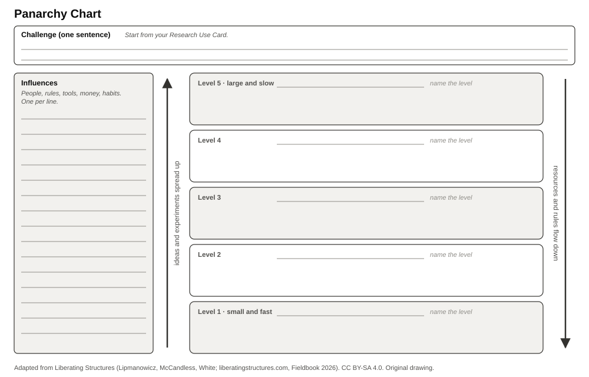

## License and attribution {.smaller}

The structures and illustrations used in this session are adapted under Creative Commons Attribution-ShareAlike 4.0 from the original work of Keith McCandless, Henri Lipmanowicz and Nancy White found at [www.liberatingstructures.com](https://www.liberatingstructures.com/) and the Liberating Structures Fieldbook (2026). Licensed under [CC BY-SA 4.0](https://creativecommons.org/licenses/by-sa/4.0/).

These slides are licensed under CC BY-SA 4.0. The diagrams are original drawings. The deck uses no Liberating Structures icons.

::: notes
Read the attribution briefly. It is a license condition, and it tells participants where to learn more.
:::

## Learning question

> What changes across interconnected levels would make generative AI use in academic research more responsible?

::: notes
This is the common question of the afternoon. Each participant turns it into their own challenge: one sentence, starting from their Research Use Card.
:::

## 1. Levels change at different speeds

- Small, local levels change fast: a project can change next week.
- Large levels change slowly: a university, an industry, or a law changes over years.
- Panarchy helps a group "identify opportunities and obstacles for spreading ideas at multiple levels".

[Liberating Structures, Panarchy; Holling (2001) on the adaptive cycle.]{.source}

::: notes
Use the image of nested dolls: zoom in, zoom out.
:::

## 2. Influence runs both ways

- Ideas and experiments can spread upwards.
- Resources, rules, and memory flow downwards.
- A fast level often waits for a slow one. A slow level often ignores a fast one.

## 3. Discover your own levels

An illustration, not a template:

> individual research project → research group or department → university and research sector → model vendors and industry → regulation and society

::: notes
Say clearly: each participant finds their own levels. Some add funders, publishers, or disciplines.
:::

## The Panarchy Chart

{fig-alt="Panarchy Chart for one participant. At the top, a field for the challenge in one sentence. On the left, a ruled field for the influences. On the right, five horizontal bands from level 1, small and fast, at the bottom to level 5, large and slow, at the top. An arrow on the left points up: ideas and experiments spread up. An arrow on the right points down: resources and rules flow down."}

[Sheet 1, back. Original diagram, adapted from Liberating Structures Panarchy. CC BY-SA 4.0.]{.source}

## A short case {.smaller}

[Hypothetical example]{.label}

A department wants researchers to disclose their use of generative AI.

- **Project level:** researchers have no template and do not know what to write.
- **Department level:** a template would take one afternoon, but nobody owns it.
- **University level:** the licensed chatbot has no documented training data, so a disclosure stays vague.
- **Vendor level:** the vendor gains from vagueness.

Leverage: the department writes the template (fast), and asks the university to add documentation to the next procurement (slow).

[This example is invented for teaching.]{.source}

## Block 1 · before the break {.smaller}

| Minutes | Format  | What happens                                                                   |
| ------: | ------- | ------------------------------------------------------------------------------ |
|      15 | Alone   | Frame the challenge from your Research Use Card. List the influences.          |
|      20 | Pairs   | Translate the influences into levels. Compare your levels.                     |
|       5 | Plenary | Form new groups of four.                                                       |
|      15 | Groups  | Present your challenge and your Panarchy Chart.                                |
|       5 | Groups  | Select one challenge.                                                          |
|      10 | Alone   | Identify Opportunities & Barriers for the selected challenge. Sheet 2, part A. |
|      25 | Groups  | Discuss, prioritize, and consolidate into a group Action Plan.                 |
|      10 | Groups  | Buffer: complete the group Action Plan.                                        |

[Steps, labels, and durations adapted from Liberating Structures Panarchy.]{.source}

::: notes
The facilitator guide gives the spoken prompt for each step. Before a group prioritizes, record each objection about consent, rights, or a burden on one group. A majority does not settle it. Keep all Panarchy Charts for Block 2.
:::

## Block 2 · after the break

Form new pairs across the groups of Block 1. Avoid a partner who already discussed your challenge.

- **Two open challenges:** examine both.
- **One open challenge:** both of you examine it.

1. **Alone, 10 minutes.** Opportunities & Barriers for the open challenges. Sheet 2, part B.
2. **Pairs, 35 minutes.** Discuss, prioritize, and record findings and possible actions.

::: notes
Pair each participant whose challenge was selected with a participant whose challenge is open. Every challenge must receive an in-depth discussion in Block 1 or Block 2.
:::

## Your individual Action Plan

**Alone, 20 minutes.** Sheet 2, back. For your own Research Use:

- the intended change,
- the next step,
- the barriers,
- the timeline,
- the success indicator.

**Pairs, 10 minutes.** Peer review: is the next step concrete? Is the timeline realistic? Would the success indicator show the change?

## Expected output

- Your own Panarchy Chart with your challenge, influences, and levels.
- Opportunities & Barriers for your challenge, from Block 1 or Block 2.
- A group Action Plan for each group of four.
- Your individual Action Plan, reviewed by a peer.

## Sources {.smaller}

- Liberating Structures: [Panarchy](https://www.liberatingstructures.com/panarchy).
- McCandless and White (2026): [The Liberating Structures Fieldbook](https://www.liberatingstructures.com/2026-fieldbook).
- Holling (2001): [Understanding the Complexity of Economic, Ecological, and Social Systems](https://doi.org/10.1007/s10021-001-0101-5).

## Takeaway

> Responsible use is not only a personal choice. Find the level where a change is feasible, and the allies at the levels above and below.

[Slides: CC BY-SA 4.0, adapted from Liberating Structures.]{.source}

::: notes
Transition to the closing: "Take your Action Plan home. It is the start of your Responsible GenAI Use Statement."
:::
